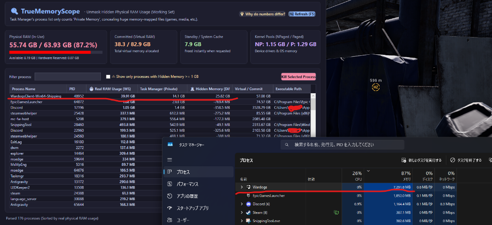

# 🔍 TrueMemoryScope (真のメモリ診断ツール)

**タスクマネージャーで見えない「真の物理メモリ消費量」を暴くWindows専用診断ツール**

[](LICENSE)
[](https://microsoft.com/windows)
[](https://github.com/PowerShell/PowerShell)

タスクマネージャーのプロセス一覧では隠れてしまう、ゲームや巨大アプリの**実際の物理メモリ消費量（ワーキングセット）**や**ファイルマッピング領域**を正確に可視化します。インストール不要・完全スタンドアロンで動作します。

[English README](README.md) | [日本語ドキュメント (Japanese)](README_JA.md)

---

## 📸 実際の比較検証：タスクマネージャー vs TrueMemoryScope

以下は、Unreal Engine製ゲーム（Wardogs）起動中の実際の画面比較です：



- **Windows タスクマネージャーの表示:** `Wardogs` は **約 7.2 GB** しか使っていないように見えます。
- **TrueMemoryScope の実態表示:** 実際には **39.91 GB** もの物理RAMを占有しています！
- **🚨 隠れメモリ (差分):** タスクマネージャーのプロセス一覧には載らないファイルマップ領域が **25.82 GB** も存在していました。

---

## 🧐 なぜタスクマネージャーの数値と食い違うのか？

PCを使っていて、以下のような疑問を感じたことはありませんか？
> *「64GBもRAMがあるのに55GB（87%）も使われている。でもタスクマネージャーのプロセス一覧を見ても、どう足しても15GB程度にしかならない。残りの40GBはどこへ消えたのか？！」*

### Windowsのメモリ表示の仕様と「罠」
Windowsのタスクマネージャーの「プロセス」タブにある「メモリ」列は、仕様上**『プライベート作業セット（他のアプリと絶対に共有されない独自メモリ）』**のみを集計しています。

しかし、最新の3Dゲーム（Unreal Engine製など）や動画編集ソフトは、膨大なテクスチャや3Dモデル、アセットデータを**『メモリマップトファイル（ファイルマッピング）』**として物理メモリ上に直接ロードします。
- このファイルマップ領域は、Windowsの内部分類上**「共有可能（Shareable）」**とみなされます。
- その結果、**タスクマネージャーのプロセス一覧のメモリ列からは完全に除外（非表示）**されてしまいます！
- **実例：** あるゲームプロセスが実際には物理RAMを**39.9 GB**も丸ごと占有していても、タスクマネージャー上では**「7.2 GB」**としか表示されず、残りの**25.8 GB**が不可視の「隠れメモリ」になってしまいます。

---

## 💡 TrueMemoryScope が提供する解決策

**TrueMemoryScope** は、各プロセスの**「ワーキングセット（実際の物理RAM占有量）」**と**「プライベートメモリ（タスクマネージャー表示）」**の両方をリアルタイムに並行取得し、差分を正確に可視化します。

- 🔥 **物理メモリ実消費 (WS)**：アプリが実際に物理RAMチップ上に占有している真のメモリ消費量（数値順ソート対応）
- 🚨 **隠れメモリ (差分)**：ファイルマッピング等によりタスクマネージャーで見えなくなっている差分メモリ
- ⚠️ **隠れメモリ 1GB 以上を一発抽出**：見かけと実態の乖離が大きいアプリをワンクリックで特定
- 🎯 **強制終了機能**：異常消費しているプロセスをその場で安全に終了
- 🚀 **完全インストール不要**：Windows標準の PowerShell + WPF だけで動作。Pythonや追加ソフト、管理者権限すら不要です。

---

## 🖥️ 画面構成と機能

- **システム全体のメモリカード**：
  - **物理メモリ (RAM) 使用状況**：実際の使用量／合計容量（使用率に応じて色変化）
  - **コミット済み (仮想メモリ)**：アプリやOSが予約した全仮想メモリ量
  - **スタンバイ / キャッシュ**：必要に応じて即座に解放される待機キャッシュ
  - **カーネル プール**：非ページプール／ページプール（デバイスドライバ等のメモリリーク特定）
- **プロセス一覧グリッド**：
  - 各列ヘッダークリックによる正確な数値ソート（大きい順／小さい順）
  - プロセス名のインクリメンタル検索
  - 実行ファイルパスの確認

---

## 🚀 起動方法

### 日本語版
フォルダー内の **`Launch_JA.bat`** をダブルクリックするだけです。

### 英語版 (English Version)
フォルダー内の **`Launch_EN.bat`** をダブルクリックするだけです。

---

## 📁 フォルダー構成

```text
TrueMemoryScope/
├── assets/
│   └── preview.png           # 比較スクリーンショット
├── Launch_JA.bat             # 日本語版ランチャー
├── Launch_EN.bat             # 英語版ランチャー
├── README_JA.md              # 日本語ドキュメント
├── README.md                 # 英語ドキュメント
├── LICENSE                   # MITライセンス
│
├── TrueMemoryScope_JA/       # 日本語版パッケージ
│   ├── Launch_JA.bat
│   ├── app.ps1
│   └── ui.xaml
│
└── TrueMemoryScope_EN/       # 英語版パッケージ
    ├── Launch_EN.bat
    ├── app.ps1
    └── ui.xaml
```

---

## 🛠️ 動作要件

- **対応OS**: Windows 10 / Windows 11 (64-bit)
- **PowerShell**: 5.1 以降（Windows標準搭載）
- **追加インストール**: 一切不要（ダウンロード後すぐに起動可能）

---

## 📄 ライセンス

本プロジェクトは [MIT License](LICENSE) の下で公開されています。商用・個人利用問わず自由にお使いいただけます。
